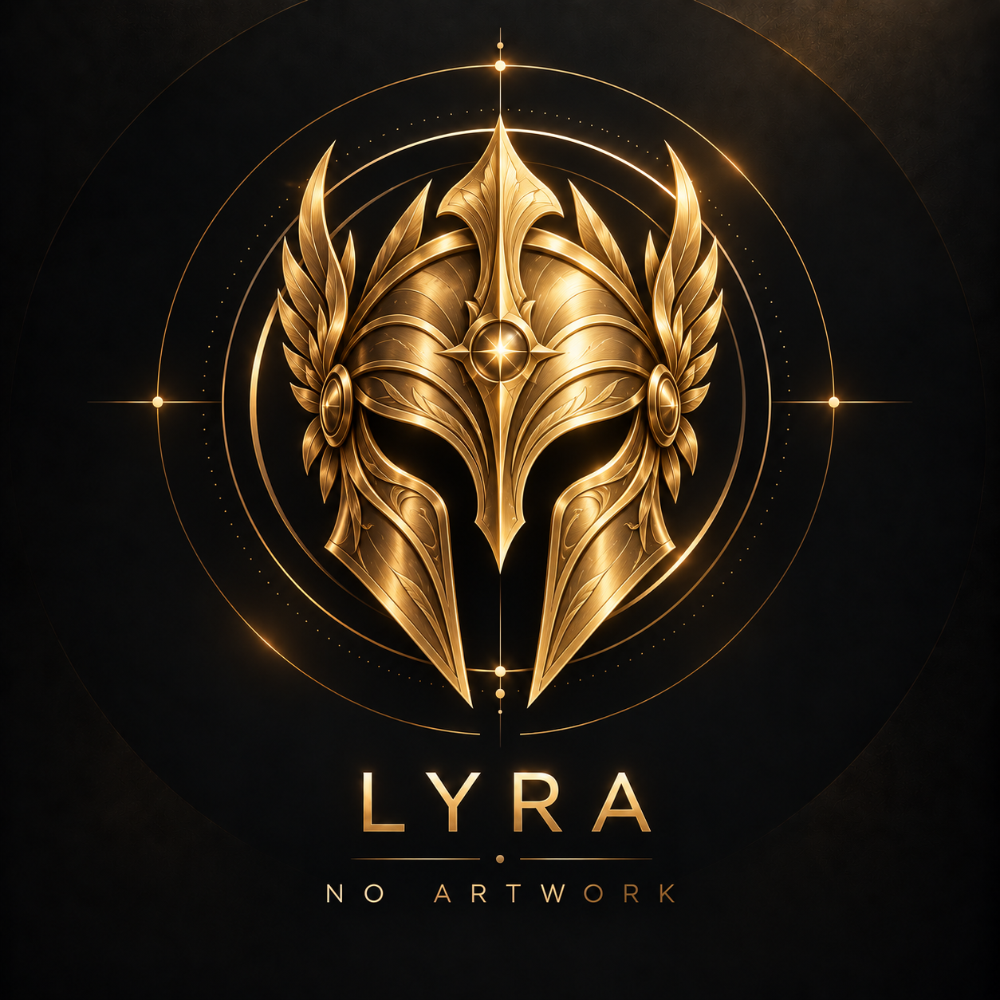
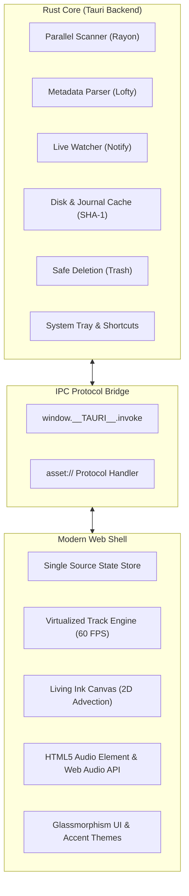

<div align="center">


# Lyra

**A refined, local-first music player crafted for Windows**

*Your library, your folders, your sound — powered by Tauri, Rust, and fluid web aesthetics.*

<p>
  <a href="#-license--credits"></a>
  
  
  
  
  
</p>

---

<p>
  <a href="#-about-lyra">About</a> •
  <a href="#-key-features">Features</a> •
  <a href="#-visual-tour">Visual Tour</a> •
  <a href="#-supported-audio-formats">Supported Formats</a> •
  <a href="#-keyboard-shortcuts">Shortcuts</a> •
  <a href="#-installation--getting-started">Installation</a> •
  <a href="#-building-from-source">Building</a> •
  <a href="#-architecture--tech-stack">Architecture</a> •
  <a href="#-icon--design-philosophy">Design</a> •
  <a href="#-license--credits">License</a>
</p>

<p align="center">
  
</p>

</div>

---

## 🎵 About Lyra

In an era of streaming lock-in, algorithmic feeds, forced subscriptions, and invasive background telemetry, **Lyra** returns control to where it belongs: your local file system and your personal audio collection.

Named after the celestial constellation of the mythical lyre, **Lyra** is a standalone, local-first desktop music player built for Windows with **Tauri** and **Rust**. It marries the agility and visual elegance of a modern web interface with the raw speed, safety, and minimal memory footprint of native systems code:

- 📂 **Folder-Is-The-Database**: No opaque database schemas to corrupt. Every subfolder containing audio files is automatically mapped as a playlist.
- ❤️ **Root Folder as Liked Songs**: Audio tracks located directly at your library's root folder assemble into your personal collection of favorites without manual tagging.
- ⚡ **Multi-Threaded Parallel Scanning**: Powered by Rust’s `rayon` and `lofty` metadata parser, Lyra indexes tens of thousands of tracks in seconds.
- 🌊 **Living Canvas & Glass Aesthetics**: A custom canvas-driven organic ink simulation advects gently behind frosted glass panels, dynamically harmonizing with your tunes.
- 🛡️ **100% Offline & Private**: Zero analytics, zero network tracking, and zero cloud accounts. What happens in your music folder stays on your machine.
- 🔄 **Real-Time Filesystem Watcher**: Background notifications detect newly dropped albums, renames, and deletions instantly without requiring manual library rescans.

---

## ✨ Key Features

### Open files from Windows Explorer

Install the latest Lyra setup, then right-click an audio file and choose **Open with → Lyra**.
To use double-click playback, select Lyra under **Choose another app** and choose **Always**
(or select Lyra for that extension in Windows **Settings → Apps → Default apps**).
Installing Lyra preserves your existing default-player choices.

Explorer opens a compact Lyra player with artwork, play/pause, seeking, and volume.
It shares playback with the library window: opening another file replaces the current
playback selection. **Open Library** shows the full interface without interrupting music.
Files can be anywhere on disk; opening them does not import their folders or change
your library. Multiple command-line file arguments play as one selection in argument order.
External selections are not restored on the next launch.

For development, launch `lyra.exe "C:\Music\Song.mp3"` to test file opening directly.
File associations are registered by the NSIS installer, not by `tauri dev`.
The custom template in `src-tauri/installer/installer.nsi` is based on Tauri CLI 1.6.3;
keep it aligned with the bundled CLI when upgrading. Its uninstall section removes
Lyra's audio-handler registrations without changing other players' associations.

<table>
  <tr>
    <td width="50%">
      <h3>📂 Folder-as-Playlist Engine</h3>
      <p>Organize music the natural way. Every folder is a playlist; drop audio in or rearrange folders in Windows Explorer and Lyra mirrors it instantly without vendor lock-in.</p>
    </td>
    <td width="50%">
      <h3>⚡ Rayon-Powered Rust Core</h3>
      <p>High-concurrency parallel directory scanning with SHA-1 content verification, multi-layer caching, and native <code>lofty</code> tag extraction for instantaneous launches.</p>
    </td>
  </tr>
  <tr>
    <td width="50%">
      <h3>🌊 Generative Ink Backdrop</h3>
      <p>Experience music with a living visual environment. Fluid canvas-based organic ink diffusion flows beneath frosted glass panels, reacting subtly to sound and themes.</p>
    </td>
    <td width="50%">
      <h3>🎛️ Cinematic Fullscreen Player</h3>
      <p>Immerse yourself with full-window playback featuring vibrant ambient artwork glows, vignette backdrops, oversized track typography, and vertical gesture volume control.</p>
    </td>
  </tr>
  <tr>
    <td width="50%">
      <h3>🔄 Live Folder Synchronization</h3>
      <p>Low-overhead native filesystem watching via the <code>notify</code> crate automatically catches added tracks, renames, and tag adjustments in real time.</p>
    </td>
    <td width="50%">
      <h3>⌨️ System-Wide Global Hotkeys</h3>
      <p>Control playback from games, IDEs, or full-screen apps with native Windows media keys and customizable in-app shortcut bindings.</p>
    </td>
  </tr>
  <tr>
    <td width="50%">
      <h3>🔍 Instant Fuzzy Search &amp; Virtualization</h3>
      <p>Instant token-matching across tracks, artists, albums, and playlists. Virtualized track lists render 50,000+ songs smoothly at 60 FPS without DOM lag.</p>
    </td>
    <td width="50%">
      <h3>🏷️ Non-Destructive Sidecars &amp; Tag Editor</h3>
      <p>Per-folder overrides and custom artwork live safely in lightweight sidecar files (<code>.lyra-playlist.json</code>), preserving original audio files and tag integrity.</p>
    </td>
  </tr>
</table>

---

## 🖼️ Visual Tour

### 1. Ambient Glassmorphism &amp; Generative Ink Canvas
Frosted acrylic glass panels layer over a custom real-time 2D ink fluid simulation (`ink-background.js`). The fluid dynamics evolve naturally, creating an ever-changing celestial aesthetic that stays light on CPU and GPU resources.

```
┌────────────────────────────────────────────────────────────────────────┐
│  [Lyra Logo] Lyra   [<] [>] [⌂]   [ 🔍 What do you want to play? ]     │
├───────────────────┬──────────────────────────────────┬─────────────────┤
│ 📂 Your Library   │ 🎵 Currently Viewing             │ 💿 Now Playing  │
│ ───────────────── │ ──────────────────────────────── │ ─────────────── │
│ ❤️ Liked Songs    │ Track 01 • Starlight Serenade    │ [Album Artwork] │
│ 📁 Synthwave 80s  │ Track 02 • Midnight Drive        │ Echoes in Orbit │
│ 📁 Lo-Fi Beats    │ Track 03 • Neon Horizons         │ Lyra Orchestra  │
│ 📁 Classical Flac │ Track 04 • Solar Flares          │ 02:45 ────○ 4:10│
├───────────────────┴──────────────────────────────────┴─────────────────┤
│ [⏮] [▶/⏸] [⏭]   Starlight Serenade — Lyra Orchestra   [🔀] [🔁] [🔊 80%] │
└────────────────────────────────────────────────────────────────────────┘
```

### 2. Immersive Fullscreen Now Playing
Press `F` or `F11` to dive into the fullscreen player. Lyra samples colors from the playing track's artwork to paint a deep, ambient vignette backdrop, paired with clean typography and a floating vertical volume slider.

### 3. Non-Destructive Sidecar Architecture
Custom playlist names, track orders, and custom covers are stored directly inside the music folder:
- `.lyra-playlist.json`: Stores custom titles, descriptions, and manual track sequencing.
- `.lyra-cover.*`: High-resolution custom folder covers that don't overwrite embedded audio tags.
- `.lyra-liked.json`: Tracks references for songs favorited outside the root folder.

---

## 🎧 Supported Audio Formats

Lyra is powered by native Rust decoding via the [Lofty](https://github.com/Serial-ATA/lofty-rs) metadata library:

| Format | File Extension | Type | Metadata &amp; Cover Extraction |
| :--- | :--- | :--- | :--- |
| **FLAC** | `.flac` | Lossless | Vorbis Comments, Embedded Picture Blocks |
| **MP3** | `.mp3` | Lossy | ID3v1, ID3v2.2, ID3v2.3, ID3v2.4 (APIC) |
| **WAV** | `.wav` | Uncompressed | RIFF INFO chunks, ID3v2 |
| **AAC / M4A** | `.m4a`, `.m4b`, `.aac` | Lossy / ALAC | MP4 / iTunes atoms (`covr`), ADTS |
| **Ogg Vorbis** | `.ogg`, `.oga` | Lossy | Vorbis Comments, METADATA_BLOCK_PICTURE |
| **Opus** | `.opus` | Lossy | Opus Tags, Embedded Artwork |
| **Matroska / WebM**| `.webm`, `.mka` | Container | Matroska Tagging, Audio Tracks |

---

## ⌨️ Keyboard Shortcuts

Lyra features full keyboard accessibility and customizable shortcuts:

### In-App Shortcuts
| Key | Action |
| :--- | :--- |
| <kbd>Space</kbd> | Toggle Play / Pause |
| <kbd>Ctrl</kbd> + <kbd>→</kbd> | Next Track |
| <kbd>Ctrl</kbd> + <kbd>←</kbd> | Previous Track (or restart track if &gt; 5s) |
| <kbd>↑</kbd> / <kbd>↓</kbd> | Volume Up / Down (5% increments) |
| <kbd>Ctrl</kbd> + <kbd>F</kbd> | Focus Global Search |
| <kbd>F</kbd> or <kbd>F11</kbd> | Toggle Fullscreen Player |
| <kbd>M</kbd> | Toggle Mute |
| <kbd>S</kbd> | Toggle Shuffle mode |
| <kbd>R</kbd> | Cycle Repeat mode (Off / All / One) |
| <kbd>Esc</kbd> | Close modal / Exit fullscreen / Clear selection |

### Global System Shortcuts
When enabled in **Options &gt; Global shortcuts**, Lyra responds to your hardware media keys and custom chords system-wide, even when minimized to the notification tray.

---

## 🚀 Installation &amp; Getting Started

### Running the Windows Installer
Download or build the Windows NSIS installer:
```powershell
LyraSetup.exe
```

Upon installation:
- Lyra creates Start Menu and Desktop shortcuts featuring the custom high-contrast icon.
- User preferences and disk caches are isolated in `%APPDATA%\com.lyra.sona`.
- The system tray icon enables seamless background listening without cluttering your taskbar.

### Quick Start Guide
1. **Select your Music Directory**: On first launch, click **Select Folder** and choose the root folder containing your audio library.
2. **Instant Scan**: Lyra automatically scans all subfolders in parallel, parsing audio tags and caching album covers.
3. **Playlists from Folders**: Every subdirectory is immediately available as a playlist in the left sidebar.
4. **Favorites**: Songs stored directly at your library's root appear automatically under **Liked Songs**.

---

## 🛠️ Building from Source

### Prerequisites

Ensure you have the following installed on your Windows machine:
- **Node.js** (v18+ recommended)
- **Rust &amp; Cargo** (v1.70+; install via [rustup.rs](https://rustup.rs/))
- **Visual Studio C++ Build Tools** (with *Desktop development with C++*)
- **WebView2** (pre-installed on modern Windows 10/11)

### Build Steps

1. **Clone the repository:**
   ```powershell
   git clone https://github.com/projectGloria/Lyra.git
   cd Lyra
   ```

2. **Install frontend dependencies:**
   ```powershell
   npm install
   ```

3. **Run in development mode:**
   ```powershell
   npm run dev
   ```
   This compiles the Rust backend and launches the Tauri window with live hot-reloading for the frontend.

4. **Run the automated test suite:**
   Lyra includes comprehensive regression and unit tests covering track ID hashing, queue logic, media session contracts, and canvas shaders:
   ```powershell
   npm test
   ```

5. **Package the production installer:**
   ```powershell
   npm run build
   ```
   The production-optimized release executable and NSIS installer will be generated in:
   ```
   src-tauri/target/release/bundle/nsis/Lyra_1.0.0_x64-setup.exe
   ```

---

## 🏗️ Architecture &amp; Tech Stack

Lyra is engineered around a clean separation between high-performance native systems code and a zero-latency, reactive user interface:



- **Backend**: Built with **Tauri 1.6** and **Rust**. Handles file I/O, parallel directory walks, metadata parsing, file watching, and native window chrome.
- **Frontend**: Lightweight vanilla ES2022 and modern CSS. Zero heavy frontend frameworks means minimal memory overhead, instant paint times, and rapid startup.
- **Audio Output**: Clean asset protocol streaming with Web Audio API analysis for the fluid ink visualizer.

---

## 🎨 Icon &amp; Design Philosophy

<p align="center">
  
</p>

> *"Like the ancient Lyra constellation glowing in the night sky, music should bring clarity, resonance, and harmony without distractions."*

The visual identity of Lyra reflects its core architectural tenets:
- **Celestial Serenity**: Deep cosmic midnight tones paired with luminous accents to reduce visual fatigue during late-night listening.
- **Organic Motion**: Living fluid canvas simulations represent the continuous, flowing nature of sound.
- **High Legibility**: A sharp, refined icon silhouette engineered for clear identification across Windows taskbar, system tray, and high-DPI desktop displays.

---

## 📄 License &amp; Credits

Lyra is open-source software distributed under the **[ISC License](package.json)**.

- **Author**: Lyra Contributors &amp; [projectGloria](https://github.com/projectGloria)
- **Built With**: [Tauri](https://tauri.app/), [Rust](https://www.rust-lang.org/), and [Lofty](https://github.com/Serial-ATA/lofty-rs)
- **Ecosystem**: Part of the projectGloria repository collection alongside [Kintsugi](https://github.com/projectGloria/Kintsugi).
