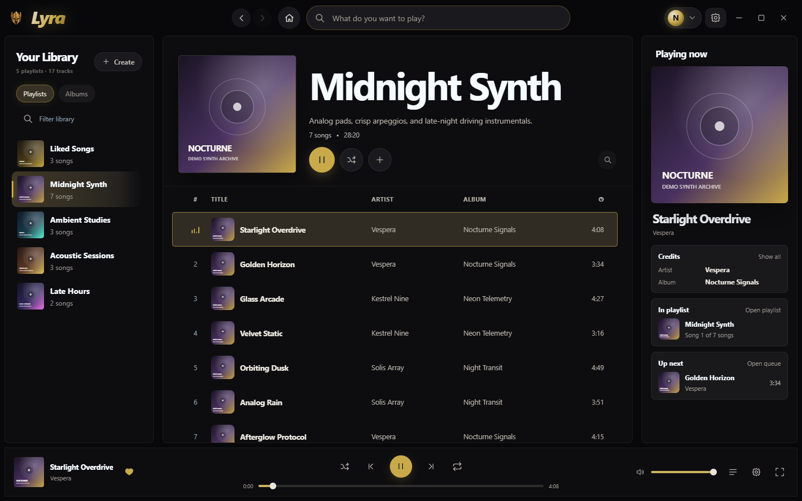
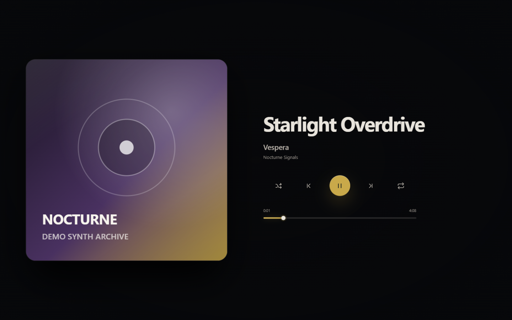
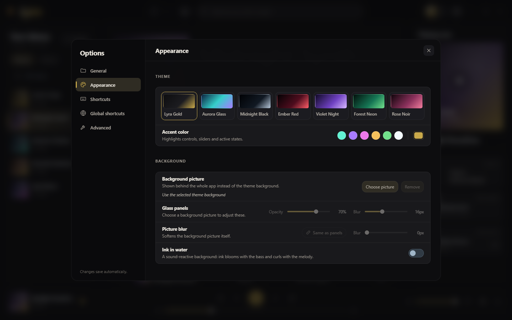
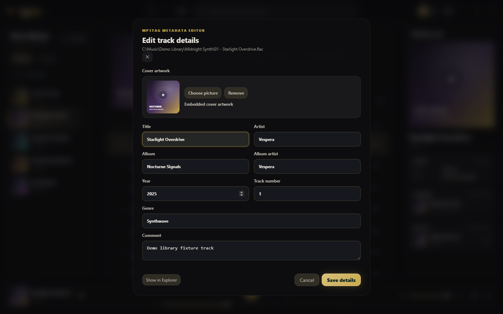
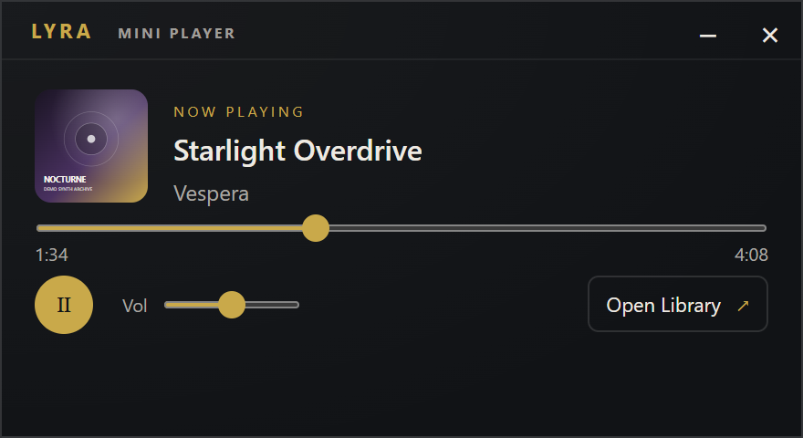
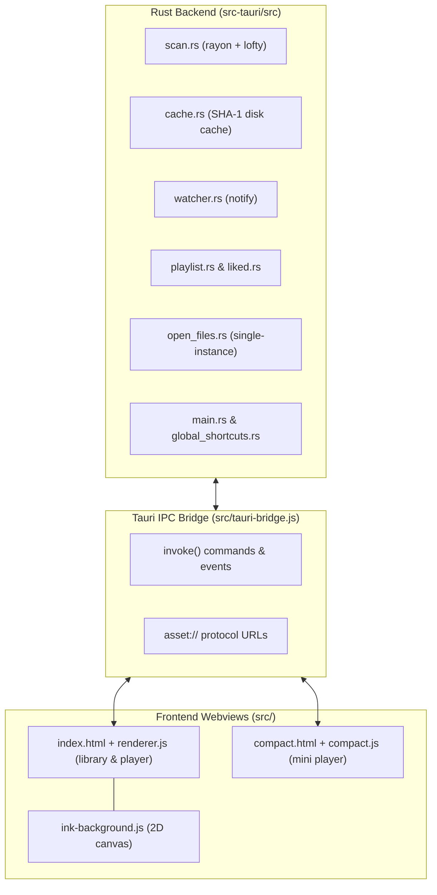

<div align="center">


# Lyra

Local-first desktop music player for Windows where every folder is a playlist.

<p>
  <a href="https://github.com/projectGloria/Lyra/actions/workflows/ci.yml"></a>
  
  
  
  <a href="LICENSE"></a>
</p>

<p>
  <a href="#about">About</a> &bull;
  <a href="#features">Features</a> &bull;
  <a href="#screenshots">Screenshots</a> &bull;
  <a href="#how-it-works">How it works</a> &bull;
  <a href="#installation">Installation</a> &bull;
  <a href="#usage">Usage</a> &bull;
  <a href="#building-from-source">Building</a> &bull;
  <a href="#contributing">Contributing</a> &bull;
  <a href="#license--credits">License</a>
</p>



</div>

---

## About

Lyra is an offline desktop music player for Windows built with Tauri, Rust, and a zero-framework web UI. Your music folder is the database: every subfolder containing audio files becomes a playlist, tracks placed directly in the library root appear under **Liked Songs**, and custom titles, descriptions, covers, and track ordering are stored in lightweight sidecar files next to your audio. There are no accounts, no cloud sync, and no telemetry.

This repository also contains a separate, standalone offline Android app (Kotlin, Jetpack Compose, Media3, Room) in [`android/`](android/README.md).

## Features

- **Folder-as-playlist library**: Organize playlists directly in Windows Explorer. Custom playlist metadata, manual track order, and liked references outside the root live in non-destructive sidecars (`.lyra-playlist.json` and `.lyra-liked.json`).
- **Fast parallel scanning and live sync**: Multi-threaded directory scanning with `rayon`, tag and cover extraction with `lofty`, SHA-1-keyed disk caching, and real-time filesystem watching via `notify`.
- **Standalone Explorer Mini Player**: Right-click any audio file in Windows Explorer and choose **Open with -> Lyra** to play it in a compact 440x240 window without importing the folder or disturbing your main library queue.
- **Built-in metadata and cover editor**: Edit title, artist, album, album artist, year, track number, genre, comment, and embedded artwork directly inside audio files.
- **Customizable appearance**: 7 built-in themes (**Lyra Gold**, **Aurora Glass**, **Midnight Black**, **Ember Red**, **Violet Night**, **Forest Neon**, **Rose Noir**), custom accent colors, custom background images with glass opacity/blur sliders, and an optional sound-reactive **Ink in water** canvas.
- **Responsive playback and navigation**: Virtualized track lists, instant search across tracks/artists/albums/playlists, Up Next and History queue drawer with playlist export, fullscreen Now Playing mode, and optional minimize-to-tray background playback.
- **In-app and global hotkeys**: Rebindable keyboard and mouse-button shortcuts inside Lyra, plus opt-in system-wide hotkeys (modifier chords, F-keys, and hardware media keys) that work while minimized to the tray.

## Screenshots

<p align="center">
  
  <br /><em>Fullscreen player: ambient artwork backdrop with focused transport controls and a floating vertical volume slider.</em>
</p>

<p align="center">
  
  <br /><em>Options -> Appearance: seven built-in themes, custom accent color picker, glass panel sliders, and Ink in water toggle.</em>
</p>

<p align="center">
  
  <br /><em>Track metadata editor: edit embedded tags and cover artwork without leaving the player.</em>
</p>

<p align="center">
  
  <br /><em>Explorer Mini Player: plays files opened from Windows Explorer independently from the main library window.</em>
</p>

## How it works



The Rust core handles all filesystem I/O, parallel tag reading/writing, artwork caching, file watching, and OS integration (system tray, global shortcuts, recycle-bin deletion via `trash`, and single-instance Explorer launches). Every file path crossing to the frontend is converted to a scoped `asset://` URL inside [`src/tauri-bridge.js`](src/tauri-bridge.js), keeping the main library window (`src/index.html`) and standalone mini player (`src/compact.html`) isolated from direct filesystem access.

## Supported audio formats

Format discovery and metadata parsing are defined in [`src-tauri/src/util.rs`](src-tauri/src/util.rs) and powered by [`lofty`](https://github.com/Serial-ATA/lofty-rs):

| Format | Extensions |
| :--- | :--- |
| FLAC | `.flac` |
| MP3 | `.mp3` |
| WAV | `.wav` |
| AAC / MP4 Audio | `.m4a`, `.m4b`, `.aac` |
| Ogg Vorbis | `.ogg`, `.oga` |
| Opus | `.opus` |
| Matroska / WebM Audio | `.webm`, `.mka` |

## Installation

### Requirements

- **OS**: Windows 10 or Windows 11 (x64)
- **Runtime**: Microsoft Edge WebView2 (pre-installed on modern Windows 10/11)

### Install or run portable

Download from [GitHub Releases](https://github.com/projectGloria/Lyra/releases/latest) or build the release artifacts locally (see [Building from source](#building-from-source)):

- **Installer (`Lyra_1.0.0_x64-setup.exe`)**: Installs for the current user, registers Lyra as an available audio handler without overriding your existing default player, and adds Start Menu/Desktop shortcuts.
- **Portable (`Lyra_1.0.0_x64-portable.exe`)**: Self-contained executable with embedded frontend assets. Settings and caches are still stored in `%APPDATA%\com.lyra.sona`.

### First run

1. Launch Lyra and click **Choose folder** (or open **Options -> General -> Music folder**).
2. Select the root directory of your music library.
3. Wait a few seconds for the initial parallel scan. Subfolders appear as playlists in the left sidebar, and audio files directly in the root folder appear under **Liked Songs**.

## Usage

### Playing files from Windows Explorer

Right-click any supported audio file and choose **Open with -> Lyra** (or set Lyra as the default app in Windows **Settings -> Apps -> Default apps**).

- Explorer launches the standalone **Mini Player** with its own playback, seek bar, and volume.
- If the main library window is currently playing, it pauses and preserves its queue and position. Closing the Mini Player stops its file without resuming the library.
- Opening files from Explorer never imports their folders into your library.
- From a terminal, you can also pass one or more file paths directly:

```powershell
.\Lyra.exe "C:\Music\Track 01.flac" "C:\Music\Track 02.flac"
```

### Default keyboard and mouse shortcuts

All shortcuts can be customized or cleared in **Options -> Shortcuts**. System-wide hotkeys are unbound by default and can be configured in **Options -> Global shortcuts**.

| Default binding | Action |
| :--- | :--- |
| `Space` | Play / pause |
| `Ctrl` + `Right` | Next track |
| `Ctrl` + `Left` | Previous track |
| `Right` / `Left` | Seek forward / back 5s |
| `Up` / `Down` | Volume up / down |
| `F` | Toggle fullscreen player |
| `Mouse back` / `Mouse forward` | Navigate back / forward |

*(Mute, Like current song, Shuffle, and Repeat mode are available to bind in **Options -> Shortcuts**.)*

## Building from source

### Prerequisites

- **Node.js** (v18+ recommended; tested with Node 26)
- **Rust and Cargo** (v1.70+, per `src-tauri/Cargo.toml`) via [rustup.rs](https://rustup.rs/)
- **Visual Studio C++ Build Tools** (*Desktop development with C++* workload)
- **WebView2** (pre-installed on Windows 10/11)

### Steps

1. Clone the repository and install dependencies:

   ```powershell
   git clone https://github.com/projectGloria/Lyra.git
   cd Lyra
   npm install
   ```

2. Run in development mode:

   ```powershell
   npm run dev
   ```

3. Run the test suites:

   ```powershell
   npm test
   cargo test --manifest-path src-tauri/Cargo.toml
   ```

4. Build the production Windows installer:

   ```powershell
   npm run build
   ```

   Output installer: `src-tauri/target/release/bundle/nsis/Lyra_1.0.0_x64-setup.exe`.

   To produce both the NSIS installer and a standalone portable executable in `release/`, run [`build-release.bat`](build-release.bat):

   ```powershell
   .\build-release.bat
   ```

   Outputs:
   - `release\Lyra_1.0.0_x64-setup.exe`
   - `release\Lyra_1.0.0_x64-portable.exe`

> **Android companion app**: See [`android/README.md`](android/README.md) for JDK 21 / Android SDK 36 prerequisites and Gradle build commands.

## How to release

Releases are built automatically by [`.github/workflows/build-installers.yml`](.github/workflows/build-installers.yml) whenever a version tag matching `v*` is pushed (or when triggered manually via **Actions -> Build Installers -> Run workflow**).

1. Update the version in `package.json`, `src-tauri/tauri.conf.json`, and `src-tauri/Cargo.toml`, commit your changes, then create and push a tag:

   ```bash
   git tag v1.0.0
   git push --tags
   ```

2. Wait for the **Build Installers** workflow to finish.
3. Download the built Windows installer (`Lyra-<version>-windows-x64.exe`):
   - **Tag builds**: Attached directly to the new release on the repository's **[GitHub Releases](https://github.com/projectGloria/Lyra/releases)** page, and also available in the workflow run's **installers** artifact.
   - **Manual (`workflow_dispatch`) builds**: Available under the workflow run's **Artifacts -> installers** download in GitHub Actions.

## Configuration and diagnostics

<details>
<summary>Sidecar files, app data paths, and installer notes</summary>

- **App data directory**: `%APPDATA%\com.lyra.sona` stores `settings.json`, the library cache, and rotating diagnostic logs (with home and library paths masked; open via **Options -> Advanced -> Diagnostic reports**).
- **Folder sidecars**:
  - `.lyra-playlist.json` inside a playlist folder stores custom title, description, cover filename, and manual track order.
  - `.lyra-liked.json` at the library root stores references to tracks liked from subfolders.
- **NSIS installer template**: [`src-tauri/installer/installer.nsi`](src-tauri/installer/installer.nsi) registers audio file handlers for Windows Explorer and removes only Lyra's registrations on uninstall. It is based on `@tauri-apps/cli` 1.6.3; keep it aligned when upgrading Tauri CLI.

</details>

## Contributing

Contributions and bug reports are welcome. Before opening a pull request:

1. Run frontend regression tests (`npm test`) and Rust tests (`cargo test --manifest-path src-tauri/Cargo.toml`).
2. Keep changes focused and preserve Lyra's offline, zero-telemetry design.

## License & credits

- **License**: Distributed under the **[ISC License](LICENSE)** (also declared in [`package.json`](package.json) and [`src-tauri/Cargo.toml`](src-tauri/Cargo.toml)). The NSIS installer template in [`src-tauri/installer/`](src-tauri/installer/LICENSE-MIT) is derived from Tauri's MIT-licensed template.
- **Built with**: [Tauri](https://tauri.app/), [Rust](https://www.rust-lang.org/), [Lofty](https://github.com/Serial-ATA/lofty-rs), [Rayon](https://github.com/rayon-rs/rayon), and [Notify](https://github.com/notify-rs/notify).
